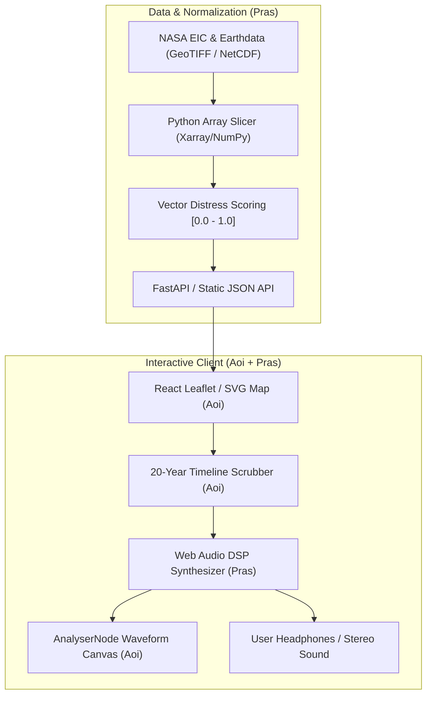

# The Earth Information Jukebox 🌍🎵
> **NASA Space Apps Challenge 2026: Multi-Sensory Earth Science Sonification Engine.**

## Team "First Person"
- **Prasiddha Das Shrestha:** Systems Architect, Data Normalization Pipelines & DSP Engine.
- **Aoi:** Frontend Architect, Interactive Map UI, Dynamic Canvas Waveform & UX Storytelling.

---

## ⚡ Git Collaboration & Branching Protocol

To ensure seamless pairing without merge conflicts:
1. `main`: Production-ready, deployed on Vercel. Only pull-requests with verified builds merge here.
2. `feat/frontend-map-ui` (Aoi's Branch): Map components, React timeline slider, HUD player console, and canvas audio visualizer.
3. `feat/audio-dsp-pipeline` (Pras's Branch): Python normalization pipelines, FastAPI endpoints, Web Audio synthesis transfer functions.

### Conventional Commit Standard
- `feat(map):` new map hotspot interaction
- `feat(audio):` pitch modulation transfer function
- `fix(ui):` canvas resizing fix
- `docs(rfc):` update architecture documentation

---

## 🏛️ System Architecture



---

## 🚀 Quickstart for Development

### 1. Frontend Setup
```bash
cd projects/earth_jukebox/frontend
# Install dependencies (React + Tailwind + Lucide)
npm install
npm run dev
```

### 2. Using Mock Data
The frontend can run 100% offline using `../data/mock_regions.json` while the backend data ingestion runs in parallel.
