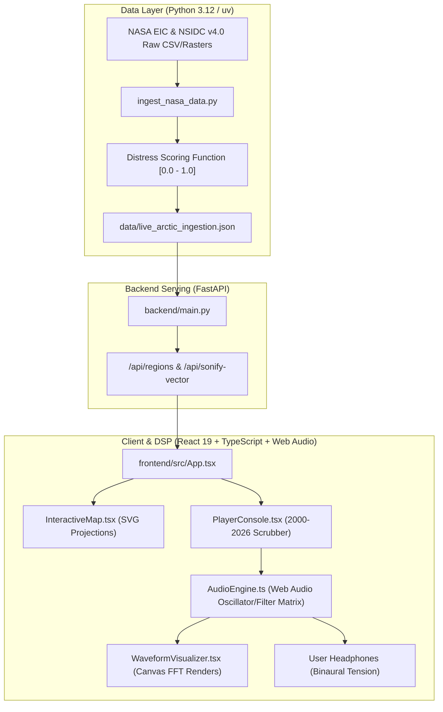

# 📖 THE REVERSE-ENGINEERING BLUEPRINT: THE EARTH INFORMATION JUKEBOX
*An educational first-principles walkthrough for Prasiddha Das Shrestha.*
*Grounded in: [projects/earth_jukebox/](file:///c:/Users/pds88/OneDrive/Documents/Knox%20College/projects/earth_jukebox)*

---

## 🏛️ I. Executive Architecture Summary

**The Earth Information Jukebox** is an end-to-end multi-sensory scientific platform built for the **2026 NASA Space Apps Challenge**. It translates multi-spectral NASA Earth observation telemetry into real-time dynamic soundscapes and acoustic harmonics.



---

## ⚡ II. The Mathematical Heart: Transfer Functions

How does a planetary observation number become an acoustic frequency? We do not generate random musical notes. We use **deterministic continuous transfer functions**:

### 1. Planetary Distress Scoring ($D$)
For any environmental indicator (such as Arctic Sea Ice extent $E$ in million square kilometers):
$$D = \text{clamp}\left(\frac{E_{\text{baseline}} - E}{E_{\text{baseline}} - E_{\text{critical}}}, 0.0, 1.0\right)$$
* Where $E_{\text{baseline}} = 6.5 \text{ million km}^2$ (stable Arctic ice pack).
* Where $E_{\text{critical}} = 3.2 \text{ million km}^2$ (catastrophic collapse).
* When ice is healthy ($E = 6.5 \implies D = 0.0$).
* When ice collapsed to record minimum ($2012 \text{ record: } E = 3.41 \implies D = 0.95$).

### 2. Fundamental Pitch Mapping ($f_0$)
We map distress linearly into the human vocal/harmonic resonance range ($180 \text{ Hz}$ to $520 \text{ Hz}$):
$$f_0(D) = 180 + 340 \times D \quad (\text{Hz})$$
* **Baseline Health ($D=0$):** $180 \text{ Hz}$ (deep, warm, resting frequency).
* **Extreme Distress ($D=1$):** $520 \text{ Hz}$ (piercing high alert).

### 3. Harmonic Dissonance & Detuning
Consonant frequencies sound soothing because their sound waves overlap cleanly. Dissonant frequencies clash and beat against the eardrum:
* **Primary Oscillator:** Sine wave at $f_0$.
* **Secondary Oscillator:** Triangle wave detuned by harmonic ratio $R(D)$:
  $$R(D) = \begin{cases} 
  1.5 - 0.086 \times D & \text{if } D \le 0.6 \quad (\text{Approaches perfect fifth } 3:2) \\
  1.059 & \text{if } D > 0.6 \quad (\text{Locks to minor second / tritone clash})
  \end{cases}$$
* When $D > 0.6$, the two oscillators beat against each other at $|f_1 - f_2| \text{ Hz}$, producing physical acoustic tension.

### 4. Biquad Low-Pass Filter Sweeps
A low-pass filter cuts off high-frequency noise. We tie filter cutoff frequency $f_c$ to distress:
$$f_c(D) = 300 + 3200 \times D \quad (\text{Hz})$$
* Low distress mutes all harsh overtones ($f_c = 300 \text{ Hz}$).
* High distress swings the filter wide open ($f_c = 3500 \text{ Hz}$), letting aggressive harmonics cut through.

---

## 🛠️ III. Codebase Map: Where Everything Lives

1. **`backend/ingest_nasa_data.py`:**
   * Ingests real NSIDC v4.0 Northern Hemisphere daily sea ice CSVs without auth barriers.
   * Aggregates September monthly means (2000–present) across 27 years of records.
   * Outputs verified mathematical vectors to `data/live_arctic_ingestion.json`.
2. **`backend/main.py`:**
   * FastAPI application with CORS enabled.
   * Exposes `/api/regions` (summary), `/api/region/{id}` (full time series), and `/api/sonify-vector` (real-time point query).
3. **`frontend/src/AudioEngine.ts`:**
   * Pure native browser Web Audio API class (`EarthAudioEngine`).
   * Manages `AudioContext`, dual oscillators (`sine` + `triangle`), `BiquadFilterNode`, `GainNode`, and `AnalyserNode`.
   * Fast ramp transitions using `linearRampToValueAtTime()` prevent pops and clicks.
4. **`frontend/src/components/InteractiveMap.tsx`:**
   * SVG-based planetary radar map projecting latitude/longitude coordinates to responsive screen points.
   * Interactive glowing pulse rings and hotspot selection.
5. **`frontend/src/components/WaveformVisualizer.tsx`:**
   * Real-time HTML5 `<canvas>` frequency renderer.
   * Queries `AnalyserNode.getByteFrequencyData()` at 60 FPS to draw neon glowing waves that transition from Cyan to Neon Red as distress surges.
6. **`frontend/src/components/PlayerConsole.tsx`:**
   * NASA HUD-style console featuring 2000–2026 scrubber slider, play/pause controls, and diagnostic readout.

---

## 🚀 IV. How to Run the Entire Stack Locally

### 1. Stand Up the Backend (Terminal 1)
```bash
cd "C:\Users\pds88\OneDrive\Documents\Knox College\projects\earth_jukebox"
uv run uvicorn backend.main:app --reload --port 8000
```
*API docs available at: `http://localhost:8000/docs`*

### 2. Stand Up the Frontend (Terminal 2)
```bash
cd "C:\Users\pds88\OneDrive\Documents\Knox College\projects\earth_jukebox\frontend"
npm run dev
```
*Web app opens at: `http://localhost:3000`*
